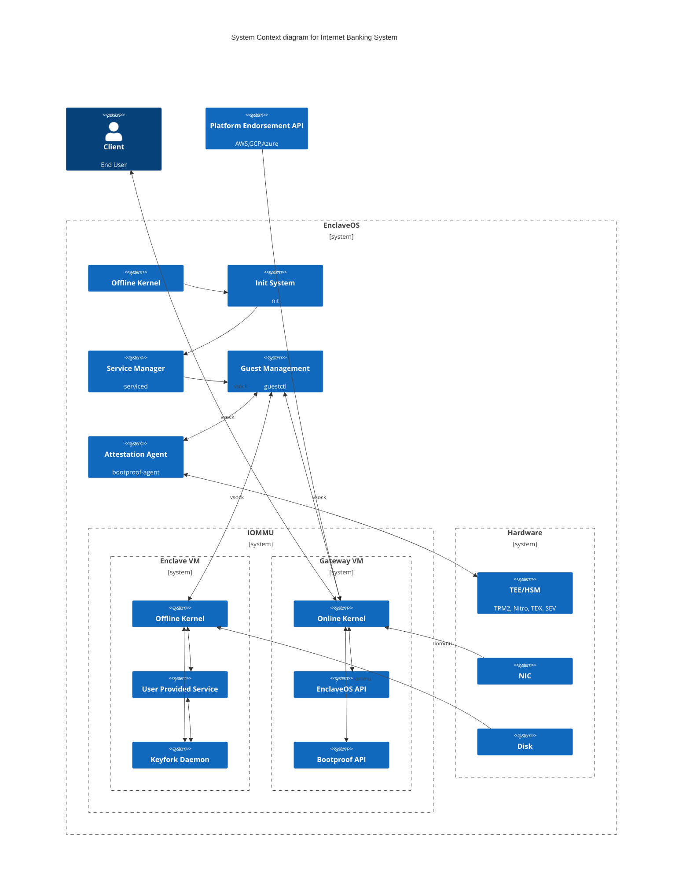

# EnclaveOS #

<https://git.distrust.co/public/enclaveos>

## About ##

A minimal, immutable, and deterministic Linux unikernel build system targeting
various Trusted Execution Environments for use cases that require high security
and accountability.

This is intended as a reference repository which could serve as a boilerplate
to build your own hardened and immutable operating system images for high
security applications.

## Architecture ##



## Platforms ##

| Platform                   | Target  | Status   | Verified boot Method  |
|----------------------------|:-------:|:--------:|:---------------------:|
| AWS Nitro Enclaves         | aws     | booting  | Nitro attestation API |
| GCP Confidential Compute   | gcp     | research | vTPM 2.0 attestation  |
| Azure Confidential VMs     | azure   | research | vTPM 2.0 attestation  |
| Generic/Qemu               | generic | research | vTPM 2.0 attestation  |

## Features ##

 * Immutability
   * Root filesystem is a CPIO filesystem extracted to a RamFS at boot
 * Minimalism
   * < 5MB footprint
   * Nothing is included but a kernel and your target binary by default
   * Sample "hello world" included as a default reference
   * Debug builds include busybox init shim and drop to a shell
 * Determinism
   * Multiple people can build artifacts and get identical hashes
   * Allows one to prove distributed artifacts correspond to published sources
 * Hardening
   * No TCP/IP network support
     * Favor using a virtual socket or physical interface to a gateway system
   * Most unessesary kernel features are disabled at compile time
   * Follow [Kernel Self Protection Project](kspp) recommendations

[  kspp]: https://kernsec.org/wiki/index.php/Kernel_Self_Protection_Project

## Development ##

### Requirements ###

 * 10GB+ free RAM
 * Docker 20+
 * GNU Make

### Build
```
make
